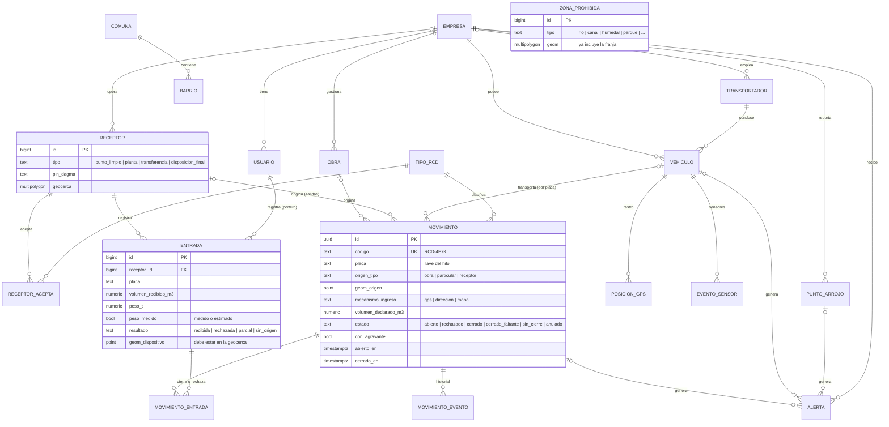
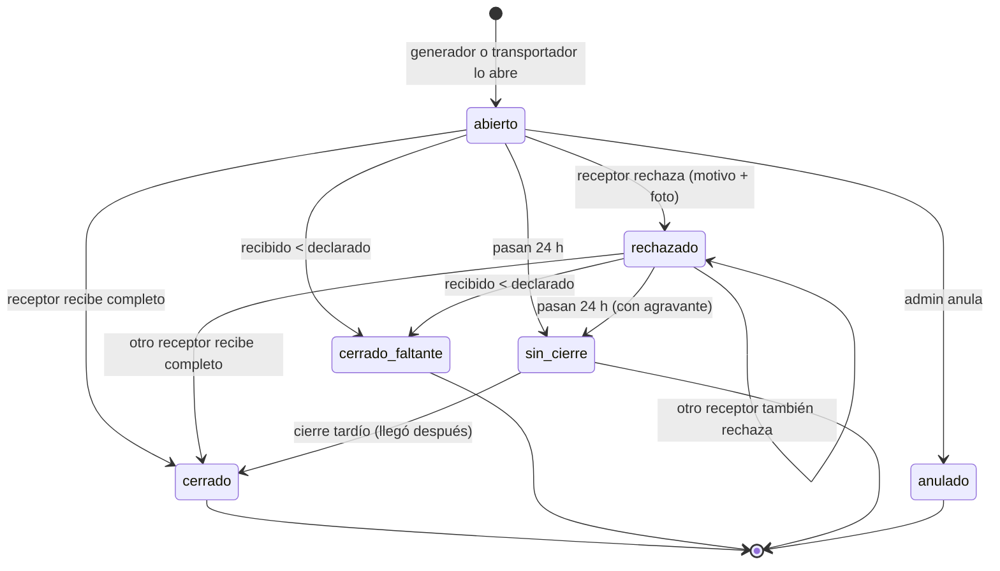
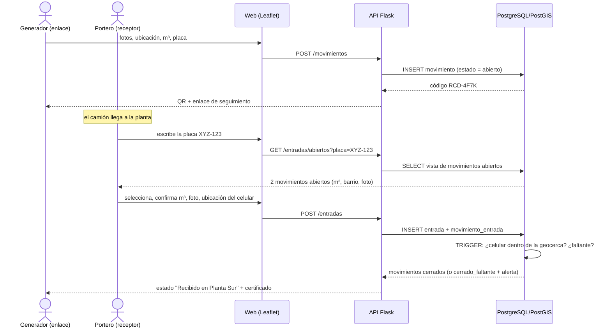
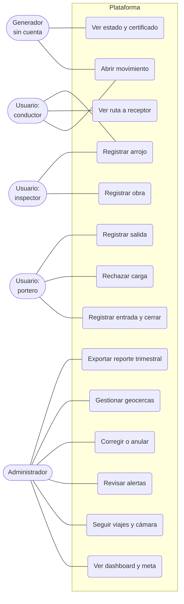

# Modelo de datos y diagramas UML

> v1 · 15-nov-2026 · Se basa en [02_diseno_funcional.md](02_diseno_funcional.md) v2. El SQL está en [`db/01_esquema.sql`](../db/01_esquema.sql).
> Los diagramas están en Mermaid: se ven en GitHub, en VS Code (con la extensión de Mermaid) o en https://mermaid.live.

## 1. Convenciones

- **SRID de almacenamiento: 4326 (WGS84)**, el que usan Leaflet y el GPS. Los cálculos en metros se hacen con `::geography`. Los datos oficiales (IDESC, en MAGNA-SIRGAS) se transforman al importarlos; la cartografía oficial nacional usa EPSG:9377.
- Las tablas **privadas** tienen `empresa_id`. Las del **registro común** se exponen con vistas de campos mínimos.
- Los estados y tipos se controlan con `CHECK` para que la base de datos rechace valores inválidos.
- Los parámetros de negocio (24 h, tolerancias, meta) están en la tabla `parametro`, no escritos en el código.

## 2. Entidades por capa

| Capa | Tabla | Qué guarda | ¿Privada? |
|---|---|---|---|
| **Referencia** | `comuna`, `barrio` | Límites de Cali (IDESC) | Común |
| | `tipo_rcd` | Catálogo de RCD: categoría aprovechable / no aprovechable y densidad (t/m³) para estimar el peso | Común |
| | `parametro` | Horas para "sin cierre", tolerancias, meta de aprovechamiento | Común |
| **1. Norma** | `receptor` | Gestores receptores inscritos con su **geocerca** (polígono). `empresa_id` vacío = inscrito pero no usa la plataforma | Común |
| | `receptor_acepta` | Qué tipos de RCD acepta cada receptor | Común |
| | `zona_prohibida` | Polígonos del art. 20 (ríos y canales con franja, parques, humedales…) | Común |
| **Empresa** | `empresa` | Gestoras que usan la plataforma | — |
| | `usuario` | Rol `admin` / `usuario`, con perfil `portero` / `conductor` / `inspector` | Privada |
| | `transportador` | Transportadores (con o sin empresa) y su PIN | Común (mínimo) |
| | `vehiculo` | Placa, capacidad, si tiene GPS o cámara | Común (placa) |
| | `obra` | Obras de los clientes de la empresa (generadores) con su geocerca | Privada |
| **2. Operación** | `movimiento` | El hilo: origen, placa, volumen declarado, estado | **Registro común** (vista mínima) |
| | `entrada` | Lo que registra el portero: placa, volumen recibido, peso, resultado | Privada del receptor |
| | `movimiento_entrada` | Qué movimientos cerró o rechazó cada entrada (una entrada puede cerrar varios) | — |
| | `movimiento_evento` | Línea de tiempo y auditoría (abierto, rechazado, cerrado, corregido, anulado…) | — |
| | `posicion_gps` | Rastro GPS de los vehículos (simulado) | Privada |
| | `evento_sensor` | Motor, compuerta, movimiento en la carga, con video (simulado) | Privada |
| | `alerta` | Sin cierre, faltante, zona prohibida, parada sospechosa, compuerta en tránsito… | Privada |
| **3. Problema** | `punto_arrojo` | Arrojos reportados en campo | Privada |

## 3. Diagrama entidad-relación

`ZONA_PROHIBIDA`, `COMUNA`/`BARRIO` y `PARAMETRO` no tienen llaves foráneas: se relacionan **espacialmente** (`ST_Within`, `ST_Intersects`), no por llaves. Eso también vale la pena explicarlo en la memoria.

## 4. UML: diagrama de estados del movimiento

## 5. UML: diagrama de secuencia, cierre por placa

## 6. UML: casos de uso

## 7. Dónde vive cada regla (siguiente fase: triggers y funciones)

| Regla (diseño §2) | Implementación prevista |
|---|---|
| Cierre solo dentro de la geocerca | Trigger en `entrada`: `ST_Within(geom_dispositivo, ST_Buffer(geocerca::geography, tolerancia))` |
| Faltante | Trigger en `movimiento_entrada`: suma de lo declarado contra lo recibido |
| Sin cierre a las 24 h | Función `marcar_sin_cierre()` ejecutada periódicamente |
| Zona prohibida / parada sospechosa | Función sobre `posicion_gps`: paradas > N min fuera de geocercas |
| Compuerta en tránsito | Trigger en `evento_sensor` |
| Peso estimado | `volumen × tipo_rcd.densidad_t_m3` cuando `peso_medido = false` |
| Línea de tiempo | Trigger que escribe en `movimiento_evento` en cada cambio de estado |
